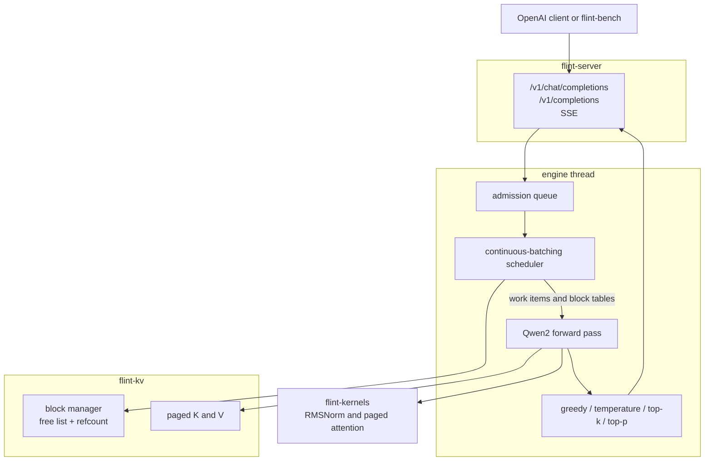

# Flint

Flint is a from-scratch LLM inference engine in Rust. Phase 1 is a CPU reference that loads a Qwen2.5-0.5B-Instruct checkpoint, runs a correct Llama-style forward pass, pages the KV cache, continuously batches requests, and serves an OpenAI-compatible API. The same benchmark client can later point at Flint, vLLM, or llama.cpp.

The end state is a server with custom CUDA kernels for Llama 3 and Qwen 2.5 models in the 0.5B–8B range: paged attention, continuous batching, speculative decoding, and 4/8-bit quantization, measured against vLLM and llama.cpp on rented NVIDIA GPUs. Phase 1 keeps every one of those ideas in the crate layout, and keeps the GPU path behind a `cuda` feature that compiles out when it is off.

## Architecture



| Crate | Job |
| --- | --- |
| `flint-kernels` | RMSNorm and paged GQA attention. CUDA sources live next to the CPU kernels and build only with `--features cuda`. |
| `flint-kv` | Block allocator (fixed-size pages, per-sequence block tables, refcounts, copy-on-write) and the K/V arrays those ids address. |
| `flint-core` | Safetensors loader, Hugging Face tokenizer, hand-written GEMM, Qwen2 forward pass, sampling. |
| `flint-schedule` | Pure iteration scheduler. It never calls the model, so the policy is unit-tested without weights. |
| `flint-server` | Engine thread plus the OpenAI HTTP API and the `flint` CLI. |
| `flint-bench` | Load generator with no dependency on the other crates. It speaks HTTP to any OpenAI-compatible server. |

## Design decisions

**Rust, and a workspace rather than one binary.** The scheduler must be testable without a model, the benchmark must be able to target vLLM, and the CUDA translation units must disappear from a CPU build. Separate crates make those boundaries compile-time facts.

**Hand-written GEMM instead of candle.** Candle is a reasonable way to get a matmul, and it would have shortened phase 1. It would also have hidden the layout this project is about: Hugging Face stores each linear as `[out, in]`, so `Y = X @ W.T`, and the KV cache is not a dense tensor. Flint's GEMM is one kernel. The dot product uses AVX2 FMA when the CPU has it, with a scalar fallback, and parallelism is across outputs rather than inside a single dot. That keeps the reduction order stable when the thread count changes, which matters when logits are compared against PyTorch. Attention, RoPE, SwiGLU, the KV cache, the scheduler, and sampling are all Flint code either way. Candle would not have made those parts shorter in a way that is worth the dependency.

**f32 after a one-time bf16 upcast.** Qwen2.5-0.5B is stored as bfloat16. The reference forward matches Hugging Face eager attention in float32, so weights are widened once at load. Casting inside the inner loop would dominate a naive GEMM and make the HF comparison noisier.

**The scheduler does not run the model.** `Scheduler::schedule` returns a feasible iteration: tokens, absolute position, block table, and whether to sample. The engine executes it and reports progress with `mark_computed` and `push_token`. A later GPU runner can execute the same plan with a fused kernel. Tests of admission, head-of-line blocking, chunked prefill, and preemption do not load a checkpoint.

**Axum.** The HTTP surface is four routes and an SSE body. Axum 0.7 expresses that directly, and streaming is a response type rather than a hand-rolled hyper loop.

**Tokenizer crate, hand-written chat template.** `tokenizer.json` is loaded with Hugging Face `tokenizers` (fancy-regex, no oniguruma). The Qwen2.5-Instruct template is a short string builder for the no-tools path, including the default system prompt. A Jinja interpreter would be a dependency for one template.

## Paged attention

K and V are not stored as `[seq, head, dim]`. They live in a single allocation per tensor, addressed by physical block id:

```text
index = (((block * num_layers + layer) * num_kv_heads + head) * block_size + slot) * head_dim + d
```

A sequence carries a block table. Token `t` is written at `(block_table[t / block_size], t % block_size)`. Attention walks the table instead of assuming the tokens are contiguous, so a scrambled table produces the same logits as an identity table. Grouped-query attention repeats each KV head across `num_query_heads / num_kv_heads` query heads, which is the `repeat_interleave` Qwen2 uses. The scale is `1/sqrt(head_dim)`. Softmax is computed in f32. V is not rotated; RoPE is applied to Q and K only, with the Llama rotate-half pattern and frequencies duplicated so the two halves share an angle.

The block manager is a free list plus a refcount. `alloc` sets the count to 1, `decref` to 0 returns the block, and `reserve` is transactional. `fork_table` increments every id so two sequences can share a prefix, and `cow_begin` / `cow_commit` plus `PagedKvCache::copy_block` split a block when one of them diverges. Phase 1's scheduler does not call the prefix API. The refcount path is implemented and tested so prefix caching does not require a new allocator.

For Qwen2.5-0.5B (24 layers, 2 KV heads, head dim 64) one block of 16 tokens is

```text
24 * 2 * 16 * 64 * 2 (K and V) * 4 bytes ≈ 384 KB
```

The default pool of 256 blocks is about 96 MB and holds 4096 tokens in total, shared across concurrent sequences. 1024 blocks is about 384 MB.

## Continuous batching

Each iteration, in order:

1. Drop any waiting sequence that can no longer fit even in an empty cache, so a grown request cannot wedge the queue.
2. Make sure every running sequence owns enough blocks for the tokens it already has. If the free list is short, preempt the newest other running sequence: its KV blocks are freed, `computed` is reset to 0, and it goes to the front of the waiting queue. It is not re-admitted in the same iteration. This is recompute preemption, not a swap to host memory. On CPU the cache already is host memory; swap becomes the right tool once KV lives on a GPU.
3. Admit waiting requests FCFS, but only while `max_num_seqs` allows it and the **entire current token list** fits in free blocks. The head of the queue is not skipped, so a long prompt cannot be starved by a stream of short ones.
4. Build the iteration. Decode steps (one new token on a sequence that has finished prefill) run before prefills, inside `max_batched_tokens`. Prefills are cut into `prefill_chunk_size`. `sample_after` is set only when the chunk reaches the last stored token, so a partial prefill does not pay for the vocabulary projection.

On CPU the engine then runs those work items one sequence at a time. The iteration is still a batch from the scheduler's point of view. A GPU phase can replace the loop with one batched GEMM and one paged-attention launch without changing admission.

The HTTP server submits prompts on a bounded channel. One engine thread owns the model, the scheduler, and the cache. Cancelling a stream sets a flag and drops the event channel; the engine frees the sequence's blocks instead of sampling into a disconnected client. Stop strings are withheld from SSE until they cannot still grow into a match (`max_stop_len - 1` characters), which is the OpenAI behavior of not emitting the stop sequence.

## Correctness

The forward pass follows the eager Qwen2 path in transformers: pre-norm residuals, RMSNorm in f32, RoPE, GQA, SwiGLU (`down(silu(gate) * up)`), and a tied LM head. Q, K, and V have bias; the output projection does not. Sliding-window attention is implemented and off for this checkpoint (`use_sliding_window` is false).

Unit tests, with no download, check:

- GEMM against a naive integer and float reference
- RoPE at position 0 (identity) and position 1 against the rotate-half formula
- sampling: greedy ties break to the lowest index, temperature 0 matches greedy, top-k and top-p reject the tail, a seed is stable
- paged attention against a dense GQA implementation, including a scrambled block table
- block alloc, free, refcount, transactional reserve, and copy-on-write
- chunked prefill equals a full prefill, and a decode step equals a full prefill of the same tokens
- scheduler admission, head-of-line blocking, decode priority, preemption, and failure when a sequence outgrows the cache
- HTTP: non-streaming and SSE chat completions, completions, stop strings, rejection of `n != 1`, and two requests sharing a cache small enough to force preemption

The checkpoint comparison is `scripts/compare_hf.py`. It dumps eager float32 logits from Hugging Face, then Flint scores the same prompts. The ignored Rust test `compare_against_hf_logits_file` reads that dump when `FLINT_MODEL_DIR` and `FLINT_HF_LOGITS` are set. CI does not download weights.

## Running

Rust 1.100 (pinned in `rust-toolchain.toml`). Fetch the checkpoint once (about 1 GB):

```bash
mkdir -p models
# config, tokenizer, and model.safetensors from Qwen/Qwen2.5-0.5B-Instruct
# or let the server download them on first launch via the Hugging Face hub
```

Serve:

```bash
cargo run --release -p flint-server -- serve \
  --model-dir models/Qwen2.5-0.5B-Instruct
```

`flint serve` without `--model-dir` downloads `Qwen/Qwen2.5-0.5B-Instruct` into the Hugging Face cache. That path uses the `hf-hub` crate with its native TLS backend, so the build needs `pkg-config` and OpenSSL headers (`libssl-dev` on Debian). `--dummy` starts a tiny random model and a byte codec so the routes can be exercised with no weights.

```bash
curl -s http://127.0.0.1:8000/health
curl -N http://127.0.0.1:8000/v1/chat/completions \
  -H 'content-type: application/json' \
  -d '{"model":"Qwen/Qwen2.5-0.5B-Instruct","messages":[{"role":"user","content":"The capital of France is"}],"max_tokens":32,"temperature":0,"stream":true}'
```

Generate and score from the CLI. `generate` defaults to temperature 0. The HTTP API defaults to temperature 1, matching OpenAI, and `temperature: 0` is greedy.

```bash
cargo run --release -p flint-server -- generate \
  --model-dir models/Qwen2.5-0.5B-Instruct \
  --chat "The capital of France is" --max-tokens 32

cargo run --release -p flint-server -- logits \
  --model-dir models/Qwen2.5-0.5B-Instruct \
  --prompt "Hello, my name is" --out /tmp/flint_logits.json
```

Benchmark any OpenAI server, including this one:

```bash
cargo run --release -p flint-bench -- \
  --url http://127.0.0.1:8000 \
  --model Qwen/Qwen2.5-0.5B-Instruct \
  --concurrency 1 --requests 4 --warmup 1 --max-tokens 32 --temperature 0 \
  --json-out bench-results/cpu.json --csv-out bench-results/cpu.csv
```

Useful server flags: `--block-size` (16), `--num-blocks` (256), `--max-num-seqs` (8), `--max-batched-tokens` (512), `--prefill-chunk-size` (128), `--max-seq-len` (2048), `--default-max-tokens` (128), `--max-new-tokens` (1024).

Compare logits with Hugging Face (CPU torch, then exit, then Flint, so the two f32 copies are not resident together):

```bash
python scripts/compare_hf.py dump \
  --model-dir models/Qwen2.5-0.5B-Instruct --out /tmp/hf_logits.json
cargo run --release -p flint-server -- logits \
  --model-dir models/Qwen2.5-0.5B-Instruct \
  --prompt "Hello, my name is" \
  --prompt "The capital of France is" \
  --prompt "Rust is a systems programming language focused on safety and speed." \
  --out /tmp/flint_logits.json
python scripts/compare_hf.py compare --hf /tmp/hf_logits.json --flint /tmp/flint_logits.json
```

## CPU numbers

Measured on a 4 vCPU Intel Xeon, no GPU, release build (opt-level 3, thin LTO, one codegen unit). Qwen2.5-0.5B-Instruct, weights upcast from bf16 to f32, greedy decoding. This is a correctness and scheduling baseline. It is not a performance claim against vLLM.

Logits versus Hugging Face transformers 5.23, eager attention, float32. Top-1 matches on every prompt. The ignored Rust test `compare_against_hf_logits_file` asserts the same comparison with a max absolute error under `1e-3`.

| Prompt | Tokens | Max abs logit | Max abs final hidden | Next token |
| --- | --- | --- | --- | --- |
| Hello, my name is | 5 | 2.7e-5 | 1.7e-4 | ` Alex` |
| The capital of France is | 5 | 4.8e-5 | 1.8e-4 | ` Paris` |
| Rust is a systems programming language focused on safety and speed. | 13 | 2.4e-5 | 7.8e-5 | ` It` |

The 16-token greedy continuation of "The capital of France is" matches Hugging Face exactly: " Paris. It is the largest city in Europe and the third largest city in the". `flint generate` reported that run as 16 tokens in 0.925 s (17.3 tok/s), prefill included. The chat form of the same question stops on eos: "The capital of France is Paris." (8 tokens, 0.85 s). A streaming completion of "Hello, my name is" starts " Alex and I am a 17", the same prefix Hugging Face produced.

`flint-bench` against `flint serve` on this machine:

| Setup | Output tokens | Throughput | TTFT p50 / p99 | ITL p50 / p99 | E2E p50 |
| --- | --- | --- | --- | --- | --- |
| Completions, concurrency 1, 32 new tokens, 5-token prompts | 128 | 19.4 tok/s | 185 / 190 ms | 46.5 / 61.9 ms | 1.67 s |
| Completions, concurrency 4, 16 new tokens | 64 | 17.5 tok/s | 649 / 913 ms | 189 / 547 ms | 3.62 s |
| Chat, concurrency 1, cap 16 (eos at 8 tokens, 34-token prefill) | 16 | 9.9 tok/s | 488 / 488 ms | 46.2 / 47.1 ms | 0.81 s |

Inter-token latency is the gap between SSE events that carry text. At concurrency 1 that gap is about 46 ms, roughly 21 decode tokens/s, and time to first token on a 5-token prompt is about 185 ms. Throughput is output tokens divided by wall time. Concurrency 4 does not raise throughput: the CPU engine still executes the scheduled batch one sequence at a time, so the extra sequences wait. A GPU batch is what removes that limit. Chat time to first token is higher because the Qwen template prefill is 34 tokens.

## What phase 1 deliberately leaves out

- The engine executes a scheduled batch one sequence at a time. There is no cross-sequence fused GEMM on CPU.
- Preemption recomputes. It does not swap KV to a side buffer.
- Block refcounts and copy-on-write are ready for prefix sharing. The scheduler does not use them yet.
- Weights are widened to f32. There is no on-the-fly bf16 GEMM, and no 4-bit or 8-bit matmul.
- The CUDA kernels are compiled only with `--features cuda` and are not called by the forward pass.
- No speculative decoding, no repetition penalty, no tool calls. `n` other than 1 is rejected; concurrency is multiple HTTP requests.
- Detokenization decodes the full generated prefix each step. Stop-string filtering then decides how much of the new suffix is safe to emit.

## CUDA plan

`flint-kernels` builds `kernels/rms_norm.cu` and `kernels/paged_attention.cu` when the `cuda` feature is on. `build.rs` is a no-op otherwise, which is why CI never passes `--all-features`.

The RMSNorm kernel is a real launch: one block per row, a warp-shuffle plus shared-memory reduction, then the scale. The paged-attention kernel is a correct slow baseline (one block per query head, scores in a local buffer capped at 4096 tokens) with the phase-2 shape written down next to it: online softmax, one warp per query head, a grid over heads and sequences, vectorized cache loads. Phase 2 replaces the CPU GEMM with cuBLAS (or a custom kernel for the shapes we actually hit), moves the paged cache to device memory, and calls these launches from `Model::forward` behind the same `LanguageModel` trait the HTTP engine already uses.

## Roadmap

**Phase 2 — GPU execution.** Device KV cache in the same block layout, cuBLAS GEMM, fused RMSNorm, the flash-style paged-attention kernel, and a batched prefill that actually fuses across sequences. Turn the prefix-sharing API on in the scheduler. Keep the CPU path as the oracle.

**Phase 3 — the comparison that the project is for.** Speculative decoding with a small draft model, 8-bit and 4-bit weight quantization, and `flint-bench` against vLLM and llama.cpp server on RTX 4090, A100, and H100. Report tokens per second, time to first token, and cost per million tokens from the same JSON the harness already writes.

## Development

```bash
cargo fmt --all -- --check
cargo clippy --workspace --all-targets -- -D warnings
cargo test --workspace --all-targets
```

GitHub Actions runs those three on push and pull request. The CUDA feature stays off. Model-download tests are `#[ignore]` and read `FLINT_MODEL_DIR`.

License: MIT.
